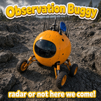

# WePlay: Observation Buggy

A Factorio 2.1 mod that adds the **Observation buggy**: a spherical scout car with a radar dish and a panoramic window. It charts the map around itself as you drive, like a radar on wheels. It also has a 4×4 equipment grid powered by a built-in 1 MW alternator.



- **Mod name:** `WePlayObservationBuggy`
- **Current version:** 0.1.2
- **Factorio:** 2.1 (`base >= 2.1`, no other dependencies)
- **Author:** afewvowels

---

## Features

| | |
|---|---|
| **Radar on wheels** | Reveals and refreshes a square of map around the buggy on a fixed timer, whether or not anyone is driving it. The radius and interval are both mod settings. |
| **Equipment grid** | 4×4 grid that takes normal armor equipment (shields, personal lasers, roboports, batteries, exoskeletons, night vision, and so on). |
| **Built-in alternator** | A hidden 1 MW power source fills the grid, so you don't need to spend cells on generators. All 16 cells are free. |
| **Player colour** | The paint takes the colour of the player who built the buggy. |
| **Custom art** | Rendered 3D model with 64 rotation directions, a player-colour mask layer and a separate shadow sheet. |
| **Custom sounds** | Its own engine start, running loop and shutdown, hatch open and close, and brake screech. |
| **Radar ping** | A soft sonar ping plays to the driver and passenger as the buggy charts. Each player picks how often, or turns it off. |
| **Wheel dust** | Kicks up dust from its rear wheels, matched to the ground: vanilla dust on vanilla tiles, Alien Biomes' own dust on its tiles, and light tan dust anywhere else. |
| **Tougher than a car** | 600 HP and a 40-slot trunk. It drives like the vanilla car because it uses the car's physics. |

### Unlock and recipe

Unlocked by **Automobilism**, alongside the vanilla car.

| Ingredient | Amount |
|---|---|
| Engine unit | 8 |
| Steel plate | 10 |
| Electronic circuit | 10 |
| Radar | 1 |

Crafting time: 3 s.

### Mod settings

| Setting | Default | Range | What it does |
|---|---|---|---|
| Chart radius | 128 tiles | 32–512 | Half-width of the square charted around each buggy. |
| Chart interval | 60 ticks (1 s) | 10–600 | How often each buggy re-charts its area. |
| Radar ping *(per player)* | 5 s | 0–60 | Seconds between radar pings while you're riding in a buggy. 0 turns it off. |

Chart radius and interval are map-wide; the ping is set by each player. All three can be changed mid-game and take effect right away.

---

## Installation

1. Download the release zip (`WePlayObservationBuggy_<version>.zip`).
2. Drop it into your Factorio `mods` folder without unzipping it.
3. Enable it in the in-game Mods menu.

You can add the mod to an existing save. Buggies placed earlier are found and tracked automatically (see [Tracking](#tracking-buggies)).

---

## Repository layout

```
WePlayObservationBuggy/
├── info.json                 Mod metadata (name, version, Factorio version, deps)
├── changelog.txt             In-game changelog
├── thumbnail.png             144×144 mod portal thumbnail
├── settings.lua              Settings stage: chart radius, interval, radar ping
├── data.lua                  Data stage: entity, item, recipe, grid, sounds, tech unlock
├── data-final-fixes.lua      Last data pass: wheel dust
├── control.lua               Runtime: charting, ping, alternator, tracking, painting
├── locale/en/locale.cfg      English names and descriptions
├── sounds/                   Engine, hatch, brake and radar ping (mono OGG)
└── graphics/
    ├── wp-observation-buggy.png         Body sheet   (2688×2912, 64 dirs)
    ├── wp-observation-buggy-mask.png    Paint mask   (2688×2912, 64 dirs)
    ├── wp-observation-buggy-shadow.png  Shadow sheet (3288×1920, 64 dirs)
    └── wp-observation-buggy-icon.png    64×64 icon
```

---

## How it works

Factorio mods load in stages. This one uses four of them:

1. **Settings stage** (`settings.lua`) declares the mod settings.
2. **Data stage** (`data.lua`) defines prototypes: the entity, the item, the recipe, the equipment grid and the sounds.
3. **Final fixes** (`data-final-fixes.lua`) sets up the wheel dust, after every other mod has loaded.
4. **Control stage** (`control.lua`) runs during play. It handles the charting, the radar ping, the alternator, tracking which buggies exist and painting them.

### `data.lua`: prototypes

#### Entity

The buggy starts as a `table.deepcopy` of the vanilla `car`, so it keeps the car's physics, collision and explosion sounds, damage effects, consumption and fuel handling. The script then changes:

- **Animation.** Replaced with three layers that share the same 64-direction, 8-per-row layout:
  - `body`: the rendered model.
  - `mask`: a grayscale paint layer with `apply_runtime_tint = true`. The engine tints it with the entity's colour.
  - `shadow`: drawn with `draw_as_shadow = true` and offset to match the light direction.

  The sheets use `scale = 0.5`, so 64 sheet pixels make one tile. The frame size and `shift` values come from the sprite packing script.
- **Removed fields.** `turret_animation`, `light_animation`, `water_reflection` and `guns` are set to `nil` because they point at vanilla car art or functions the buggy doesn't use. The exhaust smoke (`energy_source.smoke`) is removed too. The car puffs it out just behind its own small body, which is the middle of the buggy's sphere, and smoke draws above entities, so it landed on the body.
- **Sounds.** `working_sound` gets the custom engine start (`activate_sound`), loop (`sound`, with `match_speed_to_activity` so its pitch rises with speed) and shutdown (`deactivate_sound`). `open_sound` and `close_sound` get the hatch, and `stop_trigger` plays the brake screech. A separate `sound` prototype, `wp-observation-buggy-ping`, is the radar ping played from `control.lua`.
- **Collision and selection.** The collision box is 2.6×2.6 tiles, a little smaller than the sprite so it doesn't snag on every tree. The selection box is 3.4×3.4. `drawing_box_vertical_extension = 2.5` stops the tall sprite from being culled early at the top of the screen.
- **Stats.** 600 max health, 40 inventory slots, and an `equipment_grid` pointing at the custom grid.

#### Item, recipe and grid

- The **item** is a deepcopy of the vanilla car's `item-with-entity-data`, so the buggy keeps its fuel, trunk and grid contents when you pick it up. Its `order` places it right after the car in the crafting menu.
- The **recipe** starts disabled and is added to the `automobilism` technology's unlock effects. The script checks that the tech exists before modifying it.
- The **equipment grid** is 4×4 and accepts the `armor` equipment category, so any equipment that fits in power armor also fits here.

### `data-final-fixes.lua`: wheel dust

The vanilla car's `track_particle_triggers` is a list of entries, one per group of tiles, each with the particles to spawn there. Their `offsets` sit at the car's wheels, which are under the buggy's sphere, so the dust spawned in the middle of the body.

This runs in final fixes so it sees the car after every other mod has changed it. Alien Biomes, for example, adds dust entries for its own tiles:

1. **Copy the car's dust.** The buggy gets a fresh copy of `data.raw.car.car.track_particle_triggers`, including any entries other mods added.
2. **Add a default.** The car only makes dust on the tiles it lists. If no entry has `use_as_default`, one is added that covers every other tile with plain light sand dust and grit. Its `tiles` holds `out-of-map` as a placeholder, since that tile can't be driven on.
3. **Replace tile tinting.** Any effect using `apply_tile_tint` gets a fixed light tan `tint` instead. Dust tinted to the tile matched the ground so closely that it disappeared.
4. **Move to the wheels.** Every particle effect's `offsets` is set to the strut-mounted wheel pair, `{±1.55, 1.0}`, measured from the sprite. `rotate_offsets` turns them with the buggy. The other wheel pair sits behind the sphere, where dust would draw over the body, so it isn't used.

Each tile keeps its own particles, so sand still throws sand and Alien Biomes ground throws Alien Biomes' dust. Only the spawn position changes, plus the colour of tile-tinted dust.

### `control.lua`: runtime

#### Tracking buggies

Every buggy is stored in `storage.buggies`, keyed by the registration number returned from `script.register_on_object_destroyed(entity)`.

- **When a buggy is built**, it's added to the table. This covers `on_built_entity`, `on_robot_built_entity`, `script_raised_built` and `script_raised_revive`, each filtered to the buggy's name so the handler never runs for other entities.
- **When a buggy is destroyed**, `on_object_destroyed` removes it by registration number. This catches mining, death and script destruction with a single event.
- **On `on_init` and `on_configuration_changed`**, `rescan()` clears the table and searches every surface for existing buggies. This handles adding the mod to an existing save and recovers from any mismatch after other mods or Factorio are updated. Registering an entity a second time returns the same number, so rescanning is safe.
- The charting loop also removes any invalid entries it finds, as a backup.

#### Radar on wheels: `chart_all()`

At each chart interval, the script loops through every tracked buggy and calls:

```lua
force.chart(surface, {{x - r, y - r}, {x + r, y + r}})
```

`r` is the chart radius setting. This charts the full square around the buggy at once, rather than sweeping it like a vanilla radar. The area stays revealed after the buggy leaves. While the buggy stays in place, the area is re-charted every interval, which effectively gives you live map vision of it.

After charting, `ping()` runs for that buggy (see below), so pings stay in step with the charting.

The cost grows with radius² × number of buggies ÷ interval. The defaults (128 tiles, once per second) are light. A 512-tile radius at a 10-tick interval with many buggies is noticeably heavier.

#### Radar ping: `ping()` *(0.1.2)*

For each buggy that charts, the driver and passenger (`get_driver()`, `get_passenger()`) are looked up. Each one is either a player or a character with a player. For each player:

- Their `wp-observation-buggy-ping-seconds` setting is read. If it's 0, nothing plays.
- `storage.last_ping[player.index]` holds the tick of their last ping. If at least that many seconds have passed, `player.play_sound` plays the ping to that player only, and the tick is updated.

The check only happens on chart ticks, so the effective gap is the setting rounded up to the next chart. With the defaults that's every 5 s exactly.

#### Hidden alternator: `power_all()`

Every 10 ticks, each buggy gets an energy budget of:

```
1,000,000 W × 10 ticks / 60 ticks/s ≈ 166.7 kJ
```

That budget goes into the grid in two passes:

1. Every non-battery item first (shields, personal lasers, roboports, exoskeletons and so on), topped up from its current `energy` to its `max_energy`.
2. Batteries get whatever is left.

With this order, active equipment is fed first and batteries only charge from spare capacity. Any energy that doesn't fit is discarded; nothing carries over between ticks.

The alternator doesn't use the car's fuel and runs whether or not anyone is driving. A parked buggy with personal lasers works as a powered defensive post.

#### Tick scheduling

`script.on_nth_tick` only allows **one handler per interval**. If the chart interval is set to 10, the same as the power interval, a second registration would replace the first. `register_ticks()` handles this:

- It clears all `nth_tick` handlers.
- If the chart interval equals `POWER_INTERVAL`, it registers one handler that runs both `power_all()` and `chart_all()`.
- Otherwise, it registers the two handlers separately.

`register_ticks()` runs in `on_init`, `on_load` (handlers aren't saved with the game, so they have to be re-registered on every load), `on_configuration_changed`, and whenever the chart interval setting changes.

#### Paint: `paint()` *(0.1.1)*

When a buggy is built, its `color` is set to the builder's player colour, and the mask layer is tinted to match:

- For manual builds, `event.player_index` gives the player.
- For robot or script builds, which have no player index, it falls back to `entity.last_user` if that is a `LuaPlayer`.
- If neither gives a player, the buggy keeps its default colour.

---

## Compatibility notes

- **Other mods that change `automobilism`** are fine; the unlock is appended to the existing effects list.
- **Other mods that change the vanilla car prototype** before this one loads will have their changes copied into the buggy, because it's a deepcopy taken during the data stage. Usually that's what you want. If it causes problems, add an optional dependency to change the load order.
- **Alien Biomes** and other tile mods: dust entries they add to the vanilla car are picked up automatically, and any other ground gets light tan dust.
- **Space Age / multiple surfaces.** Charting uses the buggy's own surface and force, so it works on any planet the car can drive on.
- **Multiplayer.** All state lives in `storage` and every handler is deterministic, so the mod is safe for multiplayer.

---

## Development

### Sounds

All sounds are mono OGG Vorbis in `sounds/`, cut from source recordings:

| File | Use | Notes |
|---|---|---|
| `wp-observation-buggy-engine-start.ogg` | engine start | 1.8 s: starter crank and catch, fading into idle |
| `wp-observation-buggy-engine-loop.ogg` | engine loop | ~2 s seamless loop: exactly 128 firing cycles, crossfaded at the seam |
| `wp-observation-buggy-engine-stop.ogg` | engine stop | 2.3 s: 0.6 s of the loop crossfaded into the shutdown, so the loop runs straight into it |
| `wp-observation-buggy-hatch-open.ogg` | getting in | 1.0 s |
| `wp-observation-buggy-hatch-close.ogg` | getting out | 0.75 s, keeps the creak before the latch |
| `wp-observation-buggy-brake.ogg` | brake (`stop_trigger`) | 0.94 s |
| `wp-observation-buggy-ping.ogg` | radar ping | 0.85 s, the tail faded out early |

Volumes are set in `data.lua`: engine loop 0.3, start and stop 0.35, hatch 0.9, brake 0.45, ping 0.5.

### Art pipeline

The buggy is a 3D model rendered from 64 angles. The renders are cropped and packed into 8-column sheets by `tools/pack_sheets.py`, which also prints the `width`, `height` and `shift` values used in `data.lua`. If you re-render the model, run the script again and copy its output into the `body`, `mask` and `shadow` tables.

The three sheets must use identical frame order and direction count (64). The body and mask must also share the same crop.

### Packaging a release

Factorio expects a zip containing one folder named `<name>_<version>` or just `<name>`, with `info.json` inside:

```
WePlayObservationBuggy_0.1.2.zip
└── WePlayObservationBuggy/
    ├── info.json
    └── ...
```

For each release, bump `version` in `info.json` and add an entry at the top of `changelog.txt`. The changelog format is strict: a line of dashes, then `Version:`, then `Date:`, then indented categories.

---

## Changelog

**0.1.2** (2026-11-12)
- Custom sounds: engine start, running loop and shutdown, hatch open and close, and brake screech.
- Radar ping plays to the driver and passenger as the buggy charts. Per-player setting: seconds between pings, 0 = off.
- Wheel dust comes from the buggy's own rear wheels, matched to the ground. Ground with no dust of its own gets light tan dust.
- Removed the exhaust smoke, which drew over the body.

**0.1.1** (2026-11-08)
- The buggy's paint is set to the colour of the player who placed it.

**0.1.0** (2026-11-07)
- First release: observation buggy with 64-direction sprites, radar charting, an Automobilism unlock, player-colour paint, and a 4×4 grid powered by a hidden 1 MW alternator.
